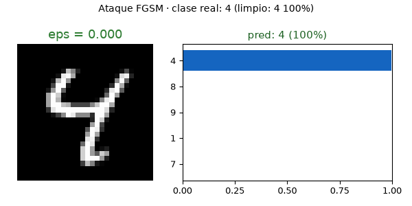
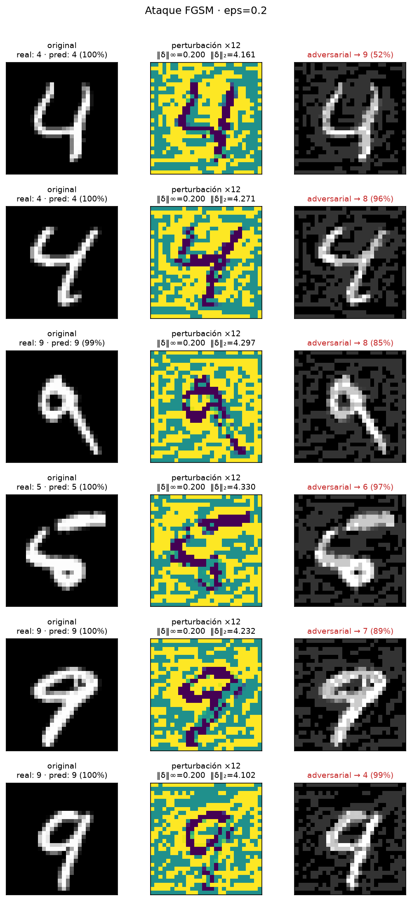
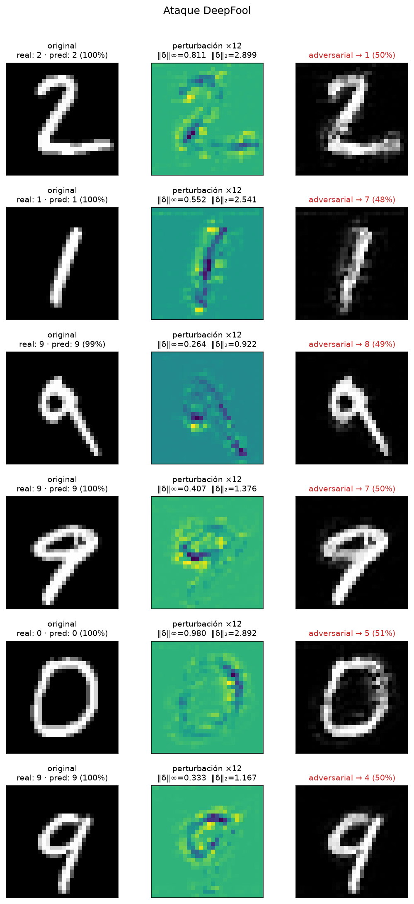
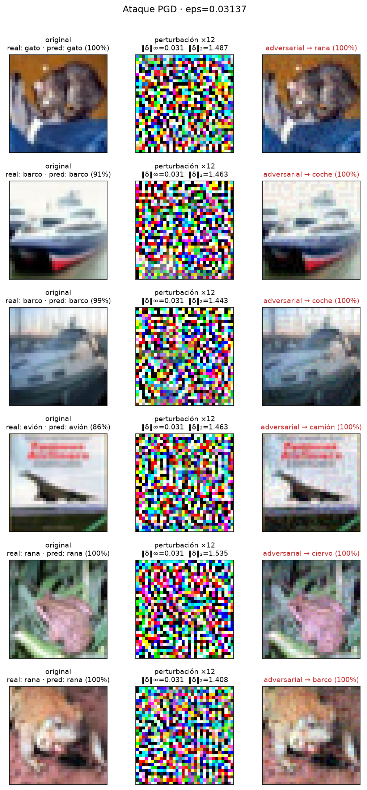
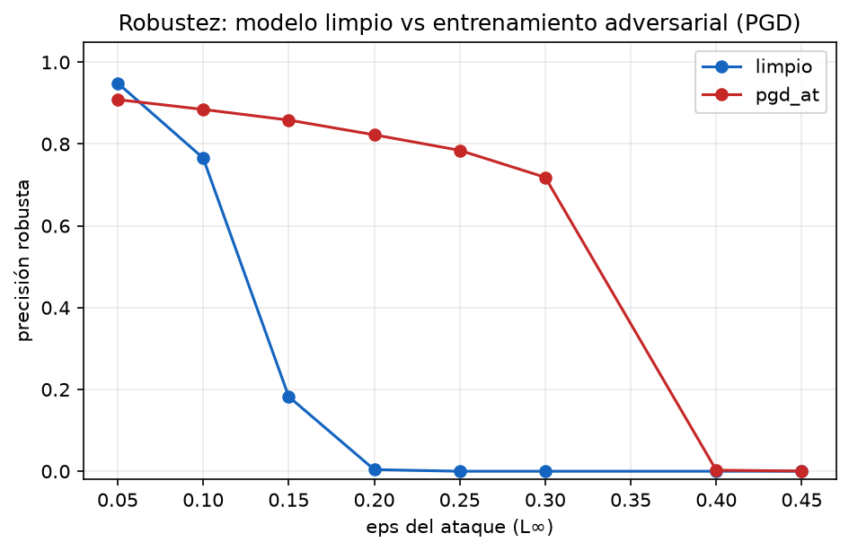

<div align="center">

# 🎯 adversarial-ml-playground

**Ataques y defensas de Machine Learning Adversarial, implementados desde cero en PyTorch, en español.**

[](https://github.com/raulp/adversarial-ml-playground/actions/workflows/ci.yml)
[](https://www.python.org/downloads/)
[](LICENSE)
[](https://github.com/psf/black)
[](tests/)

Una imagen que una CNN clasifica como **4 con 99% de confianza** se
convierte en un **8** cambiando píxeles que **ni ves**. Este repo te enseña
a construir esos ataques tú mismo, a medirlos con honestidad y a defender
un modelo contra ellos.

</div>

---

|  |
|:---:|
| *FGSM sobre MNIST: a medida que crece el presupuesto ε del atacante, la confianza salta de «4» a «8» (ε≈0.15). La perturbación real (±15% de intensidad por píxel) es casi invisible.* |

## ¿Qué es esto?

Los **ataques adversariales** son el fenómeno por el que un modelo con 99%
de precisión falla catastróficamente ante perturbaciones deliberadas e
imperceptibles. Este repo es un **playground educativo completo**:

- **5 ataques** implementados desde cero (FGSM, BIM, PGD, DeepFool, C&W),
  con su matemática derivada y explicada en los [docs](docs/).
- **3 defensas** reales: entrenamiento adversarial (Madry), transformaciones
  de entrada y randomized smoothing con certificación.
- **Resultados medidos, no prometidos**: todos los números del README salen
  de ejecutar `scripts/make_assets.py` sobre modelos entrenados aquí mismo
  (checkpoints incluidos).
- **4 notebooks** que van de "primer ataque" a "por qué fallan las defensas".
- Sin dependencias mágicas: cada ataque es un fichero corto, legible y con
  tests que verifican sus invariantes matemáticos.

## El zoo de ataques

| Ataque | Norma | Papel | Coste | Fuerza |
|---|---|---|---|---|
| [FGSM](https://arxiv.org/abs/1412.6572) | L∞ | el clásico de 1 paso | ★ | ★ |
| [BIM](https://arxiv.org/abs/1607.02533) | L∞ | FGSM iterado, pasos finos | ★★ | ★★★ |
| [PGD](https://arxiv.org/abs/1706.06083) | L∞/L2 | el estándar de facto; mide robustez | ★★ | ★★★★ |
| [DeepFool](https://arxiv.org/abs/1511.04599) | L2 | perturbación **mínima**; mide márgenes | ★★★ | — |
| [C&W](https://arxiv.org/abs/1608.04644) | L2 | optimización completa; el juez final | ★★★★★ | ★★★★★ |

|  |
|:---:|
| *FGSM (ε=0.2): original, perturbación amplificada ×12 y adversarial.* |

|  |
|:---:|
| *DeepFool: la perturbación mínima que cruza la frontera de decisión — órdenes de magnitud menor que la bola completa, y basta.* |

|  |
|:---:|
| *PGD con ε=8/255 (el estándar de CIFAR-10) sobre la ResNet ligera del repo (80.5% limpia): gato→rana, barco→coche, avión→camión… con 100% de confianza.* |

## Resultados (medidos en este repo, CPU)

Modelos entrenados aquí: `mnist_cnn.pt` (99.0% limpia) y
`mnist_cnn_adv.pt` (entrenamiento adversarial de Madry, ε=0.3).
Todos los ataques con la misma semilla; PGD con 40 pasos y arranque aleatorio.

### Robustez bajo PGD vs presupuesto del atacante

|  |
|:---:|
| *El modelo limpio colapsa a ~0% con ε=0.3; el entrenado adversarialmente resiste. Ese es el negocio entero del campo.* |

<!-- RESULTADOS_TABLA_ROBUSTEZ -->

Precisión robusta (sobre 2 000 imágenes de test) según el presupuesto ε del
atacante, con PGD de 40 pasos y arranque aleatorio:

| ε (L∞) | Modelo limpio | Modelo PGD-AT |
|---:|---:|---:|
| 0.05 | 94.9% | 90.9% |
| 0.10 | 76.6% | **88.5%** |
| 0.15 | 18.3% | **85.9%** |
| 0.20 | 0.4% | **82.3%** |
| 0.25 | 0.0% | **78.5%** |
| 0.30 | 0.0% | **71.9%** |
| 0.40 | 0.0% | 0.3% |
| 0.45 | 0.0% | 0.1% |

Dos lecturas: (1) el modelo limpio tiene robustez **cero** a partir de
ε=0.25 — su precisión del 99% no significa nada ante un atacante; (2) el
modelo AT paga 6 puntos de precisión limpia (94.7% vs 99.0%) pero resiste
hasta su frontera de entrenamiento (ε=0.3) y colapsa más allá (ε=0.4) —
la robustez que compras es *local* al ε con el que entrenaste. CSV completo:
[`results/mnist_at_comparison.csv`](results/mnist_at_comparison.csv).

### El zoo completo sobre el modelo limpio

<!-- RESULTADOS_TABLA_ZOO -->

Todos contra el modelo limpio (precisión limpia del subconjunto entre
paréntesis). CSV completo: [`results/mnist_attacks.csv`](results/mnist_attacks.csv).

| Ataque | ε | n | Precisión robusta | Éxito del ataque | ‖δ‖₂ medio |
|---|---:|---:|---:|---:|---:|
| FGSM | 0.10 | 2000 | 88.1% | 10.7% | 2.12 |
| FGSM | 0.20 | 2000 | 53.2% | 46.1% | 4.20 |
| FGSM | 0.30 | 2000 | 17.9% | 81.9% | 6.27 |
| BIM | 0.10 | 2000 | 84.4% | 14.5% | 1.76 |
| BIM | 0.20 | 2000 | 9.8% | 90.1% | 3.21 |
| BIM | 0.30 | 2000 | 0.2% | 99.9% | 4.45 |
| PGD | 0.10 | 2000 | 76.6% | 22.4% | 2.08 |
| PGD | 0.20 | 2000 | 0.4% | 99.7% | 3.90 |
| PGD | 0.30 | 2000 | 0.0% | 100% | 5.72 |
| DeepFool | — | 500 | 50.6% | 49.7% | 1.92 |
| C&W L2 | — | 256 | 0.0% | **100%** | 2.07 |

Se ven tres lecciones de una vez:

1. **La escalera FGSM < BIM < PGD** se cumple exactamente al mismo ε:
   iterar con proyección y arranque aleatorio siempre gana.
2. **DeepFool "solo" engaña al 50%** — y verificado contra torchattacks
   (48.4% con idéntica configuración): con logits muy confiados, su paso
   linealizado completo sale del dominio de píxeles y oscila al recortar.
   Es una propiedad del algoritmo, no un bug, y está analizada en
   [docs/03](docs/03-pgd.md#6-deepfool-y-cw-más-allá-del-gradiente-por-signo).
3. **C&W con poco presupuesto da falsa sensación de robustez** (1.4% de
   éxito con búsqueda binaria ×3): con el presupuesto correcto (×5, 300
   iteraciones) sube al 100%. Un ataque débil no es evidencia de un modelo
   robusto — el error más común al evaluar.

### ¿Defensas baratas? El precio de las transformaciones de entrada

<!-- RESULTADOS_TABLA_DEFENSAS -->

PGD (ε=0.3, 40 pasos) contra el modelo limpio protegido con cada
transformación (1 000 imágenes). CSV: [`results/mnist_defenses.csv`](results/mnist_defenses.csv).

| Defensa | Precisión limpia | Precisión robusta |
|---|---:|---:|
| sin defensa | 99.0% | 0.0% |
| bit-depth 3 bits | 98.8% | 0.0% |
| bit-depth 5 bits | 98.9% | 0.0% |
| JPEG q=75 | 99.0% | 0.0% |
| JPEG q=90 | 98.8% | 0.0% |
| ruido gaussiano σ=0.1 | 98.8% | 0.0% |
| TVM (minimización varianza total) | 99.0% | 0.0% |

Todas las defensas baratas conservan la precisión limpia y **no resisten
nada**: PGD las atraviesa sin adaptarse siquiera. Es la demostración
empírica de por qué las transformaciones de entrada no son una defensa
(ver [docs/04](docs/04-defensas.md)); la única que salva en este repo es
el **entrenamiento adversarial** (tabla de arriba) y el *randomized
smoothing* con garantías certificables (notebook 04).

## Inicio rápido

```bash
git clone https://github.com/raulp/adversarial-ml-playground
cd adversarial-ml-playground
python -m venv .venv && source .venv/bin/activate    # Windows: .venv\Scripts\activate
pip install -e ".[dev,app]"
```

**Opción A — usa los checkpoints incluidos** (recomendado):

```bash
# Rejilla de ataque: original | perturbación | adversarial
python -m adversarial_playground.cli demo \
    --checkpoint checkpoints/mnist_cnn.pt --attack pgd --eps 0.3 --out outputs/demo.png

# Tabla de robustez frente a varios ataques
python -m adversarial_playground.cli evaluate \
    --checkpoint checkpoints/mnist_cnn.pt --attacks fgsm,bim,pgd \
    --eps 0.1,0.2,0.3 --limit 2000 --csv results/mi_eval.csv

# GIF del ataque barrido sobre eps
python -m adversarial_playground.cli gif --checkpoint checkpoints/mnist_cnn.pt

# Demo interactiva en el navegador (Gradio)
python app/app.py
```

**Opción B — entrena tú mismo:**

```bash
# Modelo limpio (3 épocas, ~4 min en CPU)
python scripts/train.py --dataset mnist

# Entrenamiento adversarial de Madry (5 épocas, ~25 min en CPU)
python scripts/train.py --dataset mnist --adversarial

# CIFAR-10 con ResNet ligera
python scripts/train.py --dataset cifar10 --epochs 10

# Regenera TODOS los assets y CSVs de resultados del README
python scripts/make_assets.py
```

## Como librería

```python
import torch
from adversarial_playground.attacks import PGD, FGSM, DeepFool, CarliniWagnerL2
from adversarial_playground.defenses import RandomizedSmoothing, BitDepthReduction
from adversarial_playground.evaluation import evaluate_attack
from adversarial_playground.utils.data import get_loaders, load_checkpoint

model, meta = load_checkpoint("checkpoints/mnist_cnn.pt")
_, test_loader = get_loaders("mnist", batch_size=128)

# 1) Ataca: un solo número o un AttackResult completo
attack = PGD(model, eps=0.3, alpha=0.075, steps=40)
images, labels = next(iter(test_loader))
result = attack(images, labels)
print(f"Éxito: {result.success_rate:.1%} · ‖δ‖₂ medio: {result.mean_l2:.3f}")

# 2) Mide robustez con protocolo serio
ev = evaluate_attack(model, attack, test_loader, max_samples=2000)
print(f"Precisión robusta: {ev.robust_acc:.2%}")

# 3) Defiende
smooth = RandomizedSmoothing(model, sigma=0.25, n=500)
predicciones_suavizadas = smooth.predict(images)   # voto mayoritario
radios_certificados = smooth.certify(images, n=10000)  # garantía L2
```

La API completa está documentada en los docstrings; los invariantes
matemáticos de cada ataque están verificados en [tests/](tests/).

## Notebooks (español, con ejercicios)

| Notebook | Contenido |
|---|---|
| [01 · ¿Qué es un ataque adversarial?](notebooks/01_introduccion_ataques_adversariales.ipynb) | La historia, el primer FGSM, el gradiente de la entrada |
| [02 · FGSM desde cero](notebooks/02_fgsm_desde_cero.ipynb) | Derivación completa, implementación en 12 líneas, ε dirigido |
| [03 · PGD y ataques iterativos](notebooks/03_pgd_y_ataques_iterativos.ipynb) | Proyecciones, arranque aleatorio, FGSM vs BIM vs PGD, L∞ vs L2 |
| [04 · Defensas](notebooks/04_defensas.ipynb) | AT vs transformaciones vs smoothing, y la trampa del *gradient masking* |

Reconstruirlos desde la fuente: `python tools/build_notebooks.py`.

## Estructura del repo

```
adversarial-ml-playground/
├── adversarial_playground/      # el paquete
│   ├── attacks/                 #   FGSM, BIM, PGD (L∞/L2), DeepFool, C&W
│   ├── defenses/                #   PGD-AT, transformaciones, randomized smoothing
│   ├── evaluation/              #   métricas de robustez y barridos de ε
│   ├── models/                  #   CNN MNIST, ResNet CIFAR-10 (normalización interna)
│   ├── visualization/           #   rejillas, curvas y GIFs del README
│   └── cli.py                   #   comando advml (demo, evaluate, gif, train)
├── scripts/                     # train.py · evaluate.py · make_assets.py
├── notebooks/                   # 4 notebooks educativos (+ fuentes en sources/)
├── docs/                        # 5 documentos de teoría en profundidad
├── tests/                       # invariantes matemáticos de cada ataque
├── app/                         # demo Gradio desplegable en HF Spaces
├── checkpoints/                 # modelos entrenados (con metadatos)
├── assets/                      # figuras y GIF generados (los del README)
└── results/                     # CSVs con los números medidos
```

## Documentación en profundidad

| Doc | Contenido |
|---|---|
| [01 · Fundamentos](docs/01-fundamentos.md) | Modelos de amenaza, normas (L0/L2/L∞), por qué ocurre, transferibilidad |
| [02 · La matemática de FGSM](docs/02-fgsm.md) | Derivación completa con los 3 errores típicos de implementación |
| [03 · PGD](docs/03-pgd.md) | Proyecciones, arranque aleatorio, protocolo de evaluación honesto |
| [04 · Defensas](docs/04-defensas.md) | Las 3 familias reales, gradient masking, y cómo no engañarte |
| [05 · Referencias](docs/05-referencias.md) | Los 20 papers y recursos que de verdad importan |

## Tests

Cada ataque verifica sus invariantes matemáticos (no solo "que no explote"):

```bash
pytest -m "not slow" -v     # rápido: modelos sintéticos, < 30 s
pytest -v                   # completo (descarga MNIST)
```

Ejemplos de invariantes testados: la perturbación cabe en la bola prometida,
los adversariales son imágenes válidas, PGD ≥ FGSM en tasa de éxito,
DeepFool encuentra la perturbación mínima exacta sobre un modelo lineal,
C&W minimiza la norma L2.

## Roadmap

- [ ] Ataques de caja negra: SPSA, Square Attack
- [ ] EOT completo sobre las defensas estocásticas
- [ ] TRADES como alternativa al PGD-AT de Madry
- [ ] Fashion-MNIST y SVHN como datasets adicionales
- [ ] Certificación L∞ (Columnar / forward-mode smoothing)
- [ ] Demo en Hugging Face Spaces (enlace aquí)

## Créditos y contacto

Proyecto educativo hecho con cariño por [Raúl](https://github.com/raulp).
Implementaciones propias a partir de los papers originales (referencias en
[docs/05-referencias.md](docs/05-referencias.md)); si necesitas una librería
de producción, usa [torchattacks](https://github.com/Harry24k/adversarial-attacks-pytorch),
[Foolbox](https://github.com/bethgelab/foolbox) o el
[ART de IBM](https://github.com/Trusted-AI/adversarial-robustness-toolbox).

¡Las contribuciones son bienvenidas — lee [CONTRIBUTING.md](CONTRIBUTING.md)!

## Licencia

[MIT](LICENSE)
